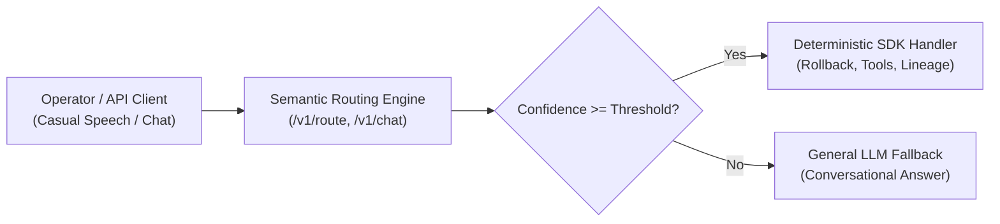

# Specification: Fuzzy Semantic Routing Engine (API <-> SDK Interface)
**Standard:** Open-Source Agent Ingress & Intent Deconfliction Layer  
**License:** Apache License, Version 2.0  
**Axiomatic Foundations:** Non-Aggression (Axiom 1) & Cleanroom Provenance (Axiom 2)

---

## 1. Executive Summary & Core Architectural Problem

Traditional agentic architectures rely on rigid regex string matches or slash commands (`/ledger`, `/deploy`, `/status`). In real-world environments, operators communicate via natural, casual speech (*"show me the ledger thing"*, *"the blah"*, *"ship it to prod"*).

The **Semantic Routing Engine (SRE)** acts as an ultra-fast, deterministic decision-making interface sitting directly between incoming **APIs** (HTTP REST, WebSocket, OpenAI-compatible `/v1/chat/completions`) and the underlying execution **SDKs** (tools, function handlers, deterministic rollback loops, and cluster commands).

### The Invariant Contract:
1. **Zero String-Lock**: Accepts conversational English without requiring command syntax.
2. **Deterministic Dispatch**: Resolves user queries into strongly-typed SDK actions in sub-10ms latency.
3. **Classical Fallback**: Operates with 100% mathematical determinism using local vector distances or token overlap; requires zero external cloud tether.



---

## 2. Mathematical Intent Matching & Scoring

For any incoming query token set $Q$ and reference utterance token set $U_i$ within route $R_k$:

$$Jaccard(Q, U_i) = \frac{|Q \cap U_i|}{|Q \cup U_i|}$$

The confidence score $C(Q, R_k)$ is evaluated across all reference utterances for route $R_k$:

$$C(Q, R_k) = \max_{U_i \in R_k} \left( \max \left( Jaccard(Q, U_i), \frac{|Q \cap U_i|}{|U_i|} \times 0.75 \right) \right)$$

If $C(Q, R_k) \ge \theta$ (default $\theta = 0.45$), the query is deterministically bound to Route $R_k$ and dispatched to its SDK callback handler.

---

## 3. API & SDK Endpoints

### Direct Route API (`POST /v1/route`)
```json
{
  "query": "show me the ledger thing",
  "context": {"user_id": "operator-01"}
}
```
**Response:**
```json
{
  "status": "routed",
  "query": "show me the ledger thing",
  "matched_route": "lineage_query",
  "confidence": 0.85,
  "result": {
    "action": "open_ledger",
    "message": "Lineage Engine Triggered"
  }
}
```

### OpenAI-Compatible API (`POST /v1/chat/completions`)
Enables drop-in replacement into any UI or framework that speaks OpenAI protocol.

---

## 4. Classical Computing & Cleanroom Invariants

1. **Zero Proprietary Keys or Trademarks**: Licensed under pure **Apache 2.0**.
2. **Offline Local First**: Operates seamlessly on local bare-metal or workstation hardware (`GAME02`) with zero external internet dependencies.
3. **Human Dignity & Safety Guard**: Conforms to Axiom 1 (Do not hurt people) and Axiom 2 (Do not take their stuff).